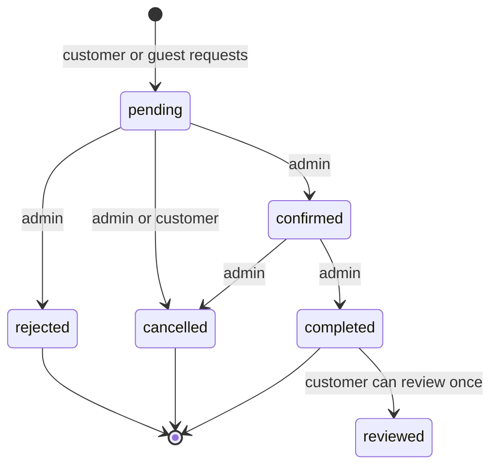
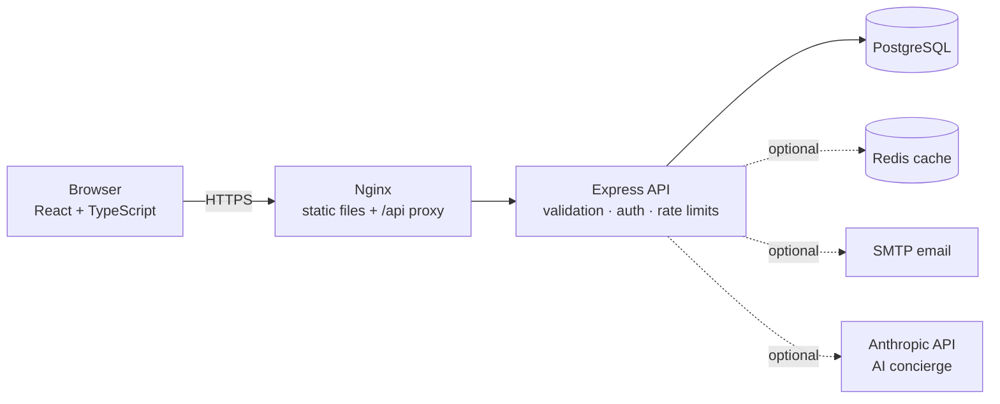

# Voyage — Travel Agency Platform (portfolio demo)

A full-stack booking platform for a fictional travel agency: customers browse tour packages and request bookings, admins review them through an explicit lifecycle, and travellers review trips they've completed.

> **This is a portfolio project, not a real agency.** Packages are sample data, no payment is taken and no trip is sold. The "AI concierge" is a real LLM call, so treat its answers as unverified.

**Live demo:** not deployed yet (a URL will be added here only once a verified deployment exists) · **Stack:** React 19 · TypeScript · Vite · Node 22 · Express 5 · PostgreSQL 16 · Redis (optional) · Docker · GitHub Actions

---

## What it does

| Role | Can do |
|---|---|
| Visitor | Browse, search, filter, sort and paginate packages; read reviews; book as a guest (name + email); chat with the AI concierge |
| Customer | Everything above, plus a dashboard: booking history, cancel pending bookings, edit profile, change password, review completed trips |
| Admin | Dashboard stats, confirm / reject / cancel / complete bookings, create / edit / deactivate / reactivate packages, manage user roles |

### Booking lifecycle

The rules live in one place (`src/domain/booking.ts`) and are enforced by the API, mirrored in the admin UI and covered by tests.



Customers can only cancel, and only while a booking is `pending`. Status changes use a guarded `UPDATE … WHERE status = <previous>`, so two admins acting at once can't silently overwrite each other (the second gets a 409).

## Architecture



```
travel-agency/            React + Vite frontend (TypeScript, CSS Modules)
  src/api/client.ts         typed API client, ApiError, token storage
  src/hooks/                useApi (race-safe fetching), useDebounce, useToast
  src/pages/ components/    Home, Packages, PackageDetail, Dashboard, Admin, Concierge, Login, Register
travel-agency-backend/    Express API (TypeScript)
  src/domain/booking.ts     booking state machine (pure, unit-tested)
  src/controllers/ routes/  thin handlers; express-validator on every input
  src/middleware/           auth, RBAC, validation, error mapping, rate limits, request log
  db/schema.sql             schema + constraints + seed data (idempotent)
  db/migrations/            upgrade script for databases created before this version
  scripts/e2e.mjs           70-check end-to-end API script
docker-compose.yml        db + redis + api + web
.github/workflows/ci.yml  typecheck, lint, tests, build, e2e, docker build
```

## Run it

### Docker (everything)

```bash
cp .env.example .env        # set POSTGRES_PASSWORD and JWT_SECRET
docker compose up --build   # app on http://localhost:8080
```

### Locally

```bash
# 1. database (no user accounts are seeded)
createdb voyage_travel && psql voyage_travel -f travel-agency-backend/db/schema.sql

# 2. API  (http://localhost:5000)
cd travel-agency-backend && cp .env.example .env   # set JWT_SECRET + DB_PASSWORD
npm install && npm run dev

# 3. an admin account of your own
ADMIN_EMAIL=you@example.com ADMIN_PASSWORD='choose-a-Strong-passw0rd' npm run create-admin

# 4. frontend  (http://localhost:5173)
cd ../travel-agency && npm install && npm run dev
```

### Admin access and the demo account

The schema creates **no** users. Create your admin with `npm run create-admin` (12+ characters; with Docker: `docker compose exec -e ADMIN_EMAIL=... -e ADMIN_PASSWORD=... api node dist/scripts/createAdmin.js`).

For a **disposable** local demo only, there is an opt-in publicly documented admin (`admin@voyage.com` / `Admin@1234`) that also shows the credentials on the Login page:

```bash
docker compose -f docker-compose.yml -f docker-compose.demo.yml up --build
```

The base `docker-compose.yml` never includes it. Do not use the demo override, `db/seed_demo_admin.sql` or `VITE_DEMO_MODE=true` on anything reachable from the internet.

Upgrading an existing database? Run `db/migrations/001_typescript_upgrade.sql` once. If it still contains the old seeded admin, change that password or delete the account.

## Testing

| Layer | Command | What it covers |
|---|---|---|
| API unit/integration | `cd travel-agency-backend && npm test` | 29 tests: state machine, env validation, auth, RBAC, validation, error shaping incl. 503 when the DB is down (DB mocked) |
| API end-to-end | `npm run test:e2e` (API + fresh DB with `seed_demo_admin.sql` loaded) | 70 checks against real PostgreSQL: full booking lifecycle, ownership, review gating, pagination caps, cache-safe package edits |
| Frontend | `cd travel-agency && npm test` | 25 tests: page rendering, error/empty states, booking modal validation and honest copy, admin action rules, package creation |
| Types & lint | `npm run typecheck` / `npm run lint` | strict TypeScript on both apps |

The GitHub Actions workflow (`.github/workflows/ci.yml`) runs on pushes to `main` and on pull requests. It type-checks, lints, tests and builds both apps, runs the end-to-end script against a PostgreSQL service container, and builds both Docker images. This is continuous integration only; nothing is deployed automatically.

**What has and hasn't been verified** (commit, environment, raw logs, remaining steps such as the first Docker Compose and GitHub Actions runs) is recorded in [`docs/VERIFICATION.md`](docs/VERIFICATION.md).

## API overview

All routes are under `/api`. Errors are JSON: `{ "error": "…" }`, and validation failures are `422` with a per-field `errors` list. Unexpected errors are logged server-side and return a generic `500`.

| Method & path | Auth | Notes |
|---|---|---|
| `POST /auth/register`, `/auth/login` | – | rate-limited (20 / 15 min / IP); role can't be set by the client |
| `GET /auth/me` · `PATCH /auth/me` · `POST /auth/change-password` | user | |
| `GET /packages` | – | `region`, `search`, `sort`, `page`, `limit` (max 50); `include_inactive` is admin-only |
| `GET /packages/:id` | – | includes reviews; cached 5 min, invalidated on any admin change |
| `POST /packages` · `PATCH /packages/:id` · `DELETE /packages/:id` | admin | delete is a soft deactivate |
| `POST /bookings` | optional | guests must supply name + email; start date must be in the future; travellers ≤ package max |
| `GET /bookings/me` · `DELETE /bookings/:id` | user | owner only; cancel allowed while `pending` |
| `GET /bookings` · `PATCH /bookings/:id/status` | admin | paginated; transitions validated against the lifecycle |
| `POST /reviews` · `GET /reviews/package/:id` | user / – | review requires a **completed** booking; one per package |
| `GET /admin/stats` · `/admin/revenue` · `/admin/users` · `PATCH /admin/users/:id/role` | admin | admins can't change their own role |
| `GET /public/stats` · `/public/reviews` | – | real numbers for the home page |
| `POST /concierge` | – | server-side proxy to the Anthropic API; 503 when no key is configured; rate-limited |
| `GET /health` | – | checks the database; reports cache as `up` / `down` / `disabled` |

## Engineering decisions

- **State machine over ad-hoc updates.** Allowed transitions are data, not scattered `if`s, so the API, UI and tests can't drift apart.
- **Prices are computed on the server** (integer cents × travellers), never trusted from the client.
- **Validation at the boundary, constraints in the database.** `express-validator` rejects bad input with clear messages; `CHECK` and `UNIQUE` constraints are the backstop (e.g. one review per user per package, `group_max ≥ group_min`).
- **Controlled errors.** `AppError` for expected failures; known Postgres error codes map to 4xx; everything else is a generic 500 with no internals leaked.
- **Safe-by-default config.** The API refuses to start without `JWT_SECRET`, and in production without a 32+ character one. CORS is limited to configured origins; `helmet` and rate limits are on.
- **Redis is optional.** With no `REDIS_URL`, or if Redis goes down, the API serves straight from PostgreSQL.
- **The API key never reaches the browser.** The concierge calls Anthropic from the server.
- **Honest UI.** Counts, ratings and testimonials on the home page come from the database and disappear when there's nothing real to show; the booking flow says "request received / pending", not "confirmed".

## Known limitations

- No payments, real inventory, seat availability or email verification.
- The JWT is stored in `localStorage` (simple, but exposed to XSS). A production system would use an httpOnly cookie plus refresh tokens.
- Package itineraries are illustrative, built from each package's highlights.
- Tests mock the DB for API unit tests and the network for UI tests. The e2e script is the real-database check.
- Not load-tested; there are no performance claims here.

## Roadmap

Availability calendar per package · admin audit log · image uploads · refresh-token auth · Playwright browser tests · k6 load test and published numbers.

---

Built by Arpan Paul.
